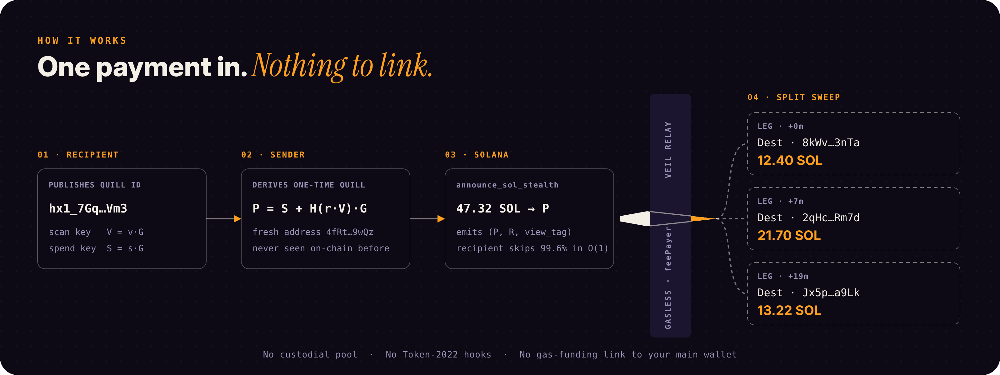
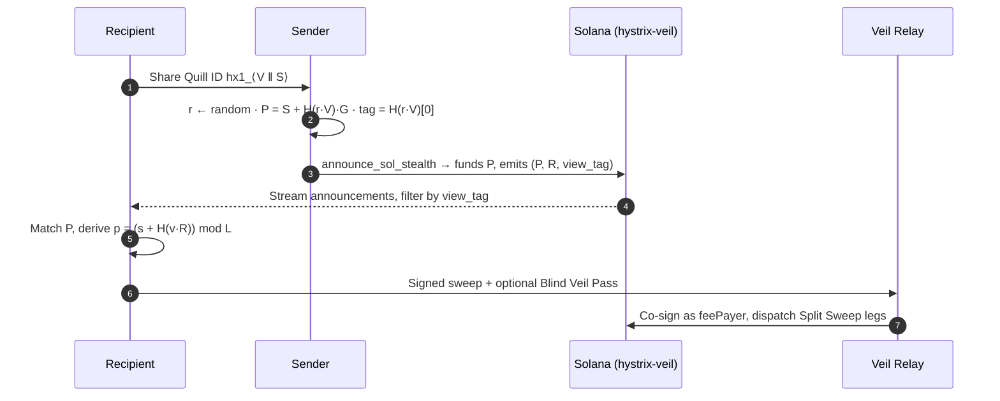
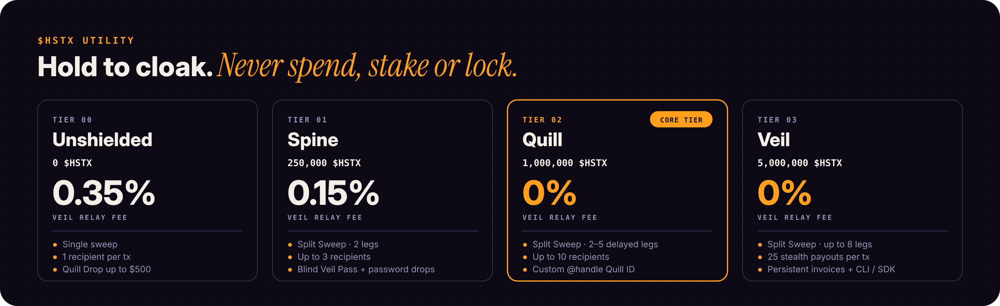

<div align="center">


<h3>Non-custodial stealth payments for Solana.</h3>

<p>
  A fresh, unlinkable address for every transfer · gasless exits · <code>0%</code> relay fees for <code>$HSTX</code> holders
</p>

<p>
  <a href="https://hystrix.online"><b>Website</b></a>
  &nbsp;·&nbsp;
  <a href="https://hystrix.online/app.html"><b>Stealth Console</b></a>
  &nbsp;·&nbsp;
  <a href="./docs/ARCHITECTURE.md"><b>Architecture</b></a>
  &nbsp;·&nbsp;
  <a href="./docs/STEALTH-DERIVATION.md"><b>ECDH Math</b></a>
  &nbsp;·&nbsp;
  <a href="./docs/BLIND-VEIL-PASS.md"><b>Blind Veil Pass</b></a>
  &nbsp;·&nbsp;
  <a href="./docs/RELAY-API.md"><b>Relay API</b></a>
  &nbsp;·&nbsp;
  <a href="https://x.com/hystrix_sol"><b>@hystrix_sol</b></a>
</p>

<p>
  
  
  
  <br />
  
  
  
</p>

</div>

---
## CA: p8JddZV7cgsLqVpGUpokX4pKXfWsZkwb3atuSZxpump
## Overview

Every Solana transfer you make exposes your main wallet: balance, positions, counterparties and every move that follows. **Hystrix (`$HSTX`)** fixes that without a mixer pool, a bridge or custom token hooks.

Recipients share one static **Quill ID** (`hx1_...`). Every payment to it lands on a **fresh 32-byte Solana address** that has never appeared on-chain and is never reused. Only the recipient can find it and spend from it.

<table>
  <tr>
    <td width="25%" valign="top">
      <h4>One-Time Quills</h4>
      Dual-key Curve25519 stealth addresses. A 1-byte view tag lets wallets skip ~99.6% of unrelated announcements in <code>O(1)</code>.
    </td>
    <td width="25%" valign="top">
      <h4>Veil Relay</h4>
      Relay nodes co-sign withdrawals only as Solana <code>feePayer</code>, so your main wallet never funds gas on a stealth address.
    </td>
    <td width="25%" valign="top">
      <h4>Split Sweep</h4>
      Withdrawals split into <code>2–8</code> uneven legs on a jittered schedule, breaking amount and timing correlation.
    </td>
    <td width="25%" valign="top">
      <h4>Blind Veil Pass</h4>
      Chaumian RSA-FDH credentials prove your <code>$HSTX</code> tier to a relay without revealing which wallet holds it.
    </td>
  </tr>
</table>

---

## Why stealth addresses alone are not enough

Generating a stealth address is half the job. Privacy breaks at three specific points, and Hystrix closes each one:

| Leak | What goes wrong | How Hystrix closes it |
| --- | --- | --- |
| **Gas funding** | You send `0.005 SOL` from your main wallet to pay fees on the stealth address and create a permanent on-chain link. | **Veil Relay** pays gas as `feePayer` and takes its fee inline from the swept asset. |
| **Timing & amount** | `47.32 SOL` arrives and `47.32 SOL` leaves 30 seconds later. Heuristics connect the two instantly. | **Split Sweep** breaks the exit into uneven, delayed legs. |
| **Token utility** | Proving your token balance at withdrawal time links your holder wallet to the private transfer. | **Blind Veil Pass** is minted once per epoch and redeemed later from a disconnected session. |

---

## How it works

<p align="center">
  
</p>



The full threat model and invariants live in [`docs/ARCHITECTURE.md`](./docs/ARCHITECTURE.md). The scalar math is specified in [`docs/STEALTH-DERIVATION.md`](./docs/STEALTH-DERIVATION.md).

---

## Repository structure

| Path | Package / Crate | What's inside |
| --- | --- | --- |
| [`packages/sdk`](./packages/sdk) | `@hystrix/sdk` | Zero-dependency Twisted Edwards Curve25519 arithmetic, `hx1_` Quill ID codec, view-tag scanner, Chaumian RSA-FDH Blind Veil Passes, Quill Drop HKDF links and the Split Sweep planner. |
| [`packages/relay`](./packages/relay) | `@hystrix/relay` | Reference **Veil Relay** HTTP fee-payer server, Blind Veil Pass verifier, nullifier rate limiter and a Poisson-jittered Split Sweep queue. |
| [`packages/cli`](./packages/cli) | `@hystrix/cli` | `hx` toolkit for key generation, stealth derivation, claim links and sweep simulation. |
| [`programs/hystrix-veil`](./programs/hystrix-veil) | `hystrix_veil` | Anchor program: `announce_sol_stealth`, `create_sol_drop`, `claim_sol_drop`, `reclaim_expired_sol_drop`, `register_handle`. |
| [`docs/`](./docs) | Specifications | Architecture, RFC 8032 stealth scalar derivation, blind holder credentials and Veil Relay HTTP endpoints. |
| [`examples/`](./examples) | Runnable demos | End-to-end TypeScript scripts that run directly on Node `>= 22.6`. |

---

## Quickstart

`@hystrix/sdk` is pure TypeScript over native Node and WebCrypto primitives, with **no external npm dependencies**. Node `22.6+` runs `.ts` files directly, so nothing needs to be installed or built:

```bash
git clone https://github.com/hystrix-protocol/hystrix.git
cd hystrix

npm test                   # ECDH, view tags, RSA-FDH blind passes, Quill Drops

npm run example:stealth    # end-to-end stealth transfer + scanning
npm run example:pass       # unlinkable 0% tier proof
npm run example:sweep      # Split Sweep plan + password-locked Quill Drop

npm run relay:dev          # local Veil Relay on http://127.0.0.1:8787
```

### `hx` CLI

| Command | What it does |
| --- | --- |
| `npm run cli -- keygen` | Generate a fresh dual-key Quill ID (`hx1_...`). |
| `npm run cli -- derive <quillId>` | Derive an unlinkable One-Time Quill address for a recipient. |
| `npm run cli -- drop <amount> <SOL\|USDC> [password]` | Create a fragment-encrypted Quill Drop claim link. |
| `npm run cli -- sweep <solAmount> <hstxBalance>` | Simulate a randomized Split Sweep schedule for a tier. |
| `npm run cli -- tiers` | Print the `$HSTX` Hold-to-Cloak tier matrix. |

---

## SDK usage

<details open>
<summary><b>1. Stealth transfer: Quill ID → One-Time Quill → recovery</b></summary>

<br />

A recipient holds two independent Curve25519 scalars: a scanning key $(v, V = v \cdot G)$ and a spending key $(s, S = s \cdot G)$, encoded with a 4-byte double-SHA-256 checksum into a shareable **Quill ID**.

```ts
import { deriveOneTimeQuill, generateQuillKeys, scanAnnouncements } from "@hystrix/sdk";

// Recipient publishes a static Quill ID (hx1_...)
const alice = generateQuillKeys();

// Sender derives a fresh, unlinkable Solana address P = S + H(r·V)·G
const announcement = deriveOneTimeQuill(alice.quillId);

// Alice filters announcements by 1-byte view tag and recovers p = (s + H(v·R)) mod L
const [received] = scanAnnouncements([announcement], {
  viewSecret: alice.viewSecret,
  spendPublic: alice.spendPublic,
  spendSecret: alice.spendSecret,
});
```

</details>

<details>
<summary><b>2. Blind Veil Pass: prove your tier without revealing your wallet</b></summary>

<br />

```ts
import {
  createBlindMintRequest,
  generateTierIssuerKey,
  issuerBlindSign,
  unblindSignature,
  verifyVeilPass,
} from "@hystrix/sdk";

const issuer = generateTierIssuerKey("quill", 2048);
const issuerPub = { tier: issuer.tier, nHex: issuer.nHex, eHex: issuer.eHex };

// Holder blinds a random pass token locally and signs once with Phantom
const state = createBlindMintRequest(issuerPub);

// Issuer checks the on-chain $HSTX balance and signs the blinded integer
const blindSig = issuerBlindSign(state.blindedMessageHex, 1_250_000, issuer);

// Browser removes the blinding factor; the issuer never sees the final pass
const pass = unblindSignature(state, blindSig, issuerPub);

// Later, from an unrelated session, any Veil Relay verifies it
verifyVeilPass(pass, issuerPub); // true
```

Full protocol: [`docs/BLIND-VEIL-PASS.md`](./docs/BLIND-VEIL-PASS.md).

</details>

<details>
<summary><b>3. Split Sweep and Quill Drop claim links</b></summary>

<br />

```ts
import { createQuillDrop, deriveOneTimeQuill, generateQuillKeys, planSplitSweep, unlockQuillDrop } from "@hystrix/sdk";

const destinations = Array.from({ length: 4 }, () =>
  deriveOneTimeQuill(generateQuillKeys().quillId).stealthAddress,
);

// Quill tier (1,000,000 $HSTX): 0% fee, up to 5 delayed legs
const plan = planSplitSweep({
  totalAtomic: 25_000_000_000n, // 25 SOL
  destinations,
  hstxBalance: 1_000_000,
});

// Lock 500 USDC behind a link; the 192-bit secret lives only in the #fragment
const drop = createQuillDrop({ amount: "500", asset: "USDC", ttlSeconds: 86_400, password: "porcupine-veil" });
const claim = unlockQuillDrop(drop.claimUrl, "porcupine-veil");
```

Browsers strip the `#fragment` from every HTTP request, so the web server never sees the claim key.

</details>

---

## `$HSTX` Hold-to-Cloak

<p align="center">
  
</p>

`$HSTX` launches fairly on **pump.fun** with an immutable **1,000,000,000** supply and **0% buy / sell tax**. Holders never stake, lock or spend tokens. They sign once with Phantom to obtain a **Blind Veil Pass**, then redeem reduced or `0%` relay fees from any stealth session, unlinked from their `$HSTX` wallet.

| Tier | Required `$HSTX` | Supply share | Veil Relay fee | Split Sweep | Multi-Quill batch | Extras |
| --- | ---: | ---: | ---: | --- | --- | --- |
| **00 · Unshielded** | `0` | `0%` | `0.35%` | Single sweep | 1 recipient | Basic Quill Drop (`$500` cap) |
| **01 · Spine** | `250,000` | `0.025%` | `0.15%` | Up to 2 legs | Up to 3 recipients | Blind Veil Pass + password drops |
| **02 · Quill** | `1,000,000` | `0.10%` | **`0%`** | **2–5 delayed legs** | Up to 10 recipients | **Custom `@handle` Quill ID** |
| **03 · Veil** | `5,000,000` | `0.50%` | **`0%`** | **Up to 8 legs** | **25 payouts / tx** | Persistent invoices + CLI / SDK |

The `0.35%` paid by non-holders refills the SOL gas reserves that power Veil Relay nodes. The on-chain program caps any relay fee at `35 bps`.

---

## Building the Solana program

```bash
# Requires Rust >= 1.79, Solana CLI >= 2.1, Anchor 0.30.1
anchor build
anchor test --skip-local-validator
```

---

## Security

Read [`SECURITY.md`](./SECURITY.md) for disclosure guidelines and [`docs/ARCHITECTURE.md`](./docs/ARCHITECTURE.md) for invariants, torsion-point checks and the non-custodial bounds on relayers. Contributions are welcome. Start with [`CONTRIBUTING.md`](./CONTRIBUTING.md).

---

<div align="center">


<p>
  <b>Sharp quills. Silent transfers.</b>
  <br />
  <a href="https://hystrix.online">hystrix.online</a>
  &nbsp;·&nbsp;
  <a href="https://x.com/hystrix_sol">@hystrix_sol</a>
  &nbsp;·&nbsp;
  Released under the <a href="./LICENSE">MIT License</a>
</p>

</div>
