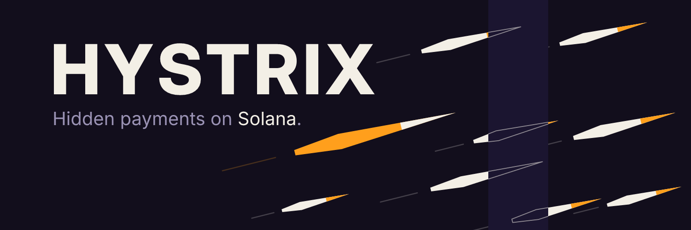

<div align="center">
  

  <br />
  <br />

  <p>
    <a href="https://hystrix.online"><b>Website &amp; Stealth Console</b></a> ·
    <a href="./docs/ARCHITECTURE.md"><b>Architecture</b></a> ·
    <a href="./docs/STEALTH-DERIVATION.md"><b>ECDH Math</b></a> ·
    <a href="./docs/BLIND-VEIL-PASS.md"><b>Blind Veil Pass</b></a> ·
    <a href="https://x.com/hystrix_sol"><b>@hystrix_sol</b></a>
  </p>

  <p>
    
    
    
    
  </p>
</div>

---

# Hystrix (`$HSTX`)

**Hystrix** is a non-custodial stealth payment layer for Solana combining **Dual-Key Curve25519 stealth addresses (`One-Time Quills`)**, **gas-sponsoring `Veil Relay` nodes**, **fragment-encrypted `Quill Drop` claim links**, and **Chaumian RSA-FDH `Blind Veil Passes`**.

Every transfer lands on a fresh 32-byte Solana address that has never appeared on-chain before and is never reused—requiring zero custom SPL Token-2022 transfer hooks and zero custodial pools.

---

## Repository Structure

| Path | Package / Crate | Description |
| --- | --- | --- |
| [`packages/sdk`](./packages/sdk) | `@hystrix/sdk` | Zero-dependency Twisted Edwards Curve25519 arithmetic, `hx1_` Quill ID codec, 1-byte view-tag scanner, Chaumian RSA-FDH Blind Veil Passes, Quill Drop HKDF link derivation, and Split Sweep planner. |
| [`packages/relay`](./packages/relay) | `@hystrix/relay` | Reference **Veil Relay** HTTP fee-payer server, Blind Veil Pass verifier, nullifier rate-limiter, and Poisson-jittered Split Sweep queue. |
| [`packages/cli`](./packages/cli) | `@hystrix/cli` | `hx` command-line toolkit for key generation, stealth address derivation, secret claim links, and sweep simulation. |
| [`programs/hystrix-veil`](./programs/hystrix-veil) | `hystrix_veil` | Solana Anchor program (`announce_sol_stealth`, `create_sol_drop`, `claim_sol_drop`, `reclaim_expired_sol_drop`, `register_handle`). |
| [`docs/`](./docs) | Specifications | Threat model, RFC 8032 stealth scalar derivation, Chaumian blind holder credentials, and Veil Relay HTTP endpoints. |
| [`examples/`](./examples) | Runnable Demos | End-to-end TypeScript scripts runnable directly with Node `>= 22.6`. |

---

## Quickstart (Zero Install Needed on Node 22.6+)

`@hystrix/sdk` is written in pure TypeScript over native Node/WebCrypto primitives with **zero external npm dependencies**, so you can verify all cryptography immediately after cloning:

```bash
git clone https://github.com/hystrix-protocol/hystrix.git
cd hystrix

# 1. Run the cryptographic test suite (ECDH, view tags, RSA-FDH blind passes, Quill Drops)
npm test

# 2. Run end-to-end protocol examples
npm run example:stealth
npm run example:pass
npm run example:sweep

# 3. Generate a fresh Quill ID & derive an unlinkable Solana stealth address via CLI
npm run cli -- keygen
npm run cli -- tiers
```

---

## How Hystrix Works

### 1. Dual-Key `Quill ID` & `One-Time Quill` (`packages/sdk/src/stealth.ts`)
A recipient generates two independent Curve25519 scalars: a scanning key $(v, V = v \cdot G)$ and a spending key $(s, S = s \cdot G)$, encoded with a 4-byte double-SHA-256 checksum into a shareable **Quill ID** (`hx1_...`).

```ts
import { deriveOneTimeQuill, generateQuillKeys, scanAnnouncements } from "@hystrix/sdk";

// Recipient publishes static Quill ID (`hx1_...`)
const alice = generateQuillKeys();

// Sender derives an unlinkable One-Time Solana address P = S + H(r*V)*G
const announcement = deriveOneTimeQuill(alice.quillId);

// Alice filters announcements in O(1) via 1-byte viewTag and recovers p = (s + H(v*R)) mod L
const [received] = scanAnnouncements([announcement], {
  viewSecret: alice.viewSecret,
  spendPublic: alice.spendPublic,
  spendSecret: alice.spendSecret,
});
```

### 2. Gasless Sweeps via `Veil Relay` & `Split Sweep` (`packages/relay`)
Funding a stealth address with `0.005 SOL` from your main Phantom wallet leaks an immediate on-chain graph link. **Veil Relay** nodes co-sign withdrawal transactions strictly as Solana `feePayer`, deducting the protocol fee inline (`<= 35 bps` enforced on-chain in `programs/hystrix-veil`). For larger balances, **Split Sweep** divides withdrawals across `2–8` non-uniform legs dispatched over exponentially jittered intervals.

### 3. `Quill Drop` Secret Claim Links (`packages/sdk/src/drop.ts`)
Lock SOL or USDC into a PDA escrow keyed by 192 bits of entropy placed exclusively in the URI `#fragment` (`https://hystrix.online/drop/250usdc?ttl=86400s#<secret>`). Browsers strip `#fragment` from all HTTP requests, so web servers never observe the claim key. Optional SHA-256 password commitments (`?lock=sha256`) protect high-value links sent over Telegram or X DMs.

### 4. Unlinkable `$HSTX` Holder Tiers (`Blind Veil Pass`)
`$HSTX` launches fairly on `pump.fun` with an immutable **1,000,000,000** supply and **0% buy/sell tax**. Holders never stake, lock, or spend tokens—they sign once with Phantom to obtain a **Chaumian RSA-FDH Blind Veil Pass** and redeem `0%` relay fees from any stealth session without linking their `$HSTX` wallet:

| Tier | Required `$HSTX` | Supply Share | Veil Relay Fee | Split Sweep | Multi-Quill Batch | Extras |
| --- | ---: | ---: | ---: | --- | --- | --- |
| **Unshielded** | `0` | `0%` | `0.35%` | Single sweep | 1 recipient | Basic Quill Drop (`$500` cap) |
| **01 · Spine** | `250,000` | `0.025%` | `0.15%` | Up to 2 legs | Up to 3 recipients | Blind Veil Pass + Password Drops |
| **02 · Quill ★** | `1,000,000` | `0.10%` | **`0.00%`** | **2–5 delayed legs** | Up to 10 recipients | **Custom `@handle` Quill ID** |
| **03 · Veil** | `5,000,000` | `0.50%` | **`0.00%`** | **Up to 8 legs** | **25 payouts / tx** | Persistent Invoices + CLI / SDK |

Non-holder `0.35%` relay fees replenish the SOL gas reserves powering Veil Relay infrastructure.

---

## Building the Solana Program

```bash
# Requires Rust >= 1.79, Solana CLI >= 2.1, Anchor 0.30.1
anchor build
anchor test --skip-local-validator
```

---

## Security & Audits

Review [`SECURITY.md`](./SECURITY.md) and [`docs/ARCHITECTURE.md`](./docs/ARCHITECTURE.md) for invariants, torsion-point checks, and non-custodial relayer bounds.

## License

Released under the [MIT License](./LICENSE).
